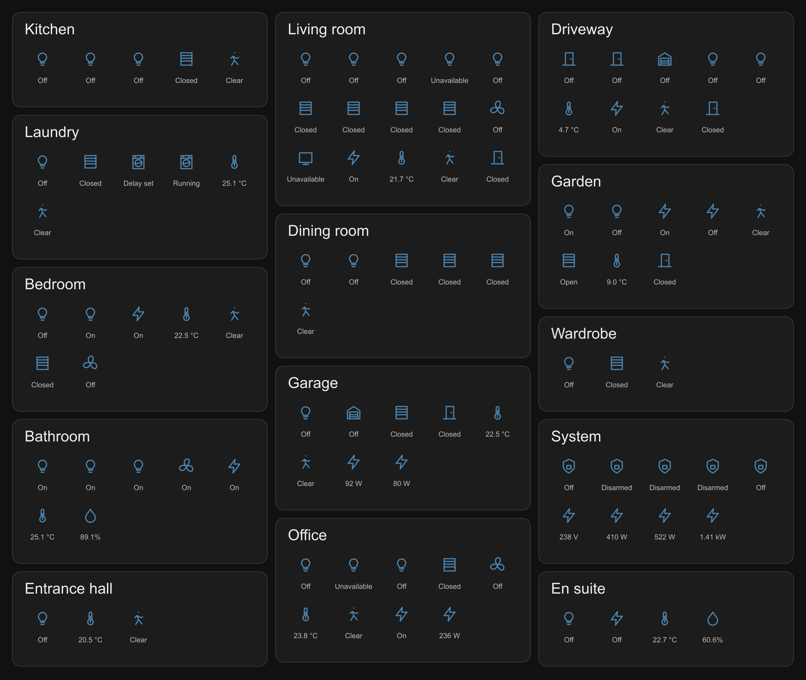
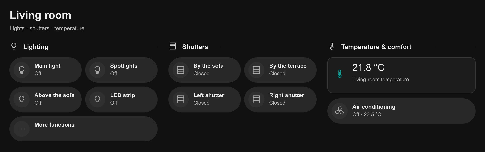
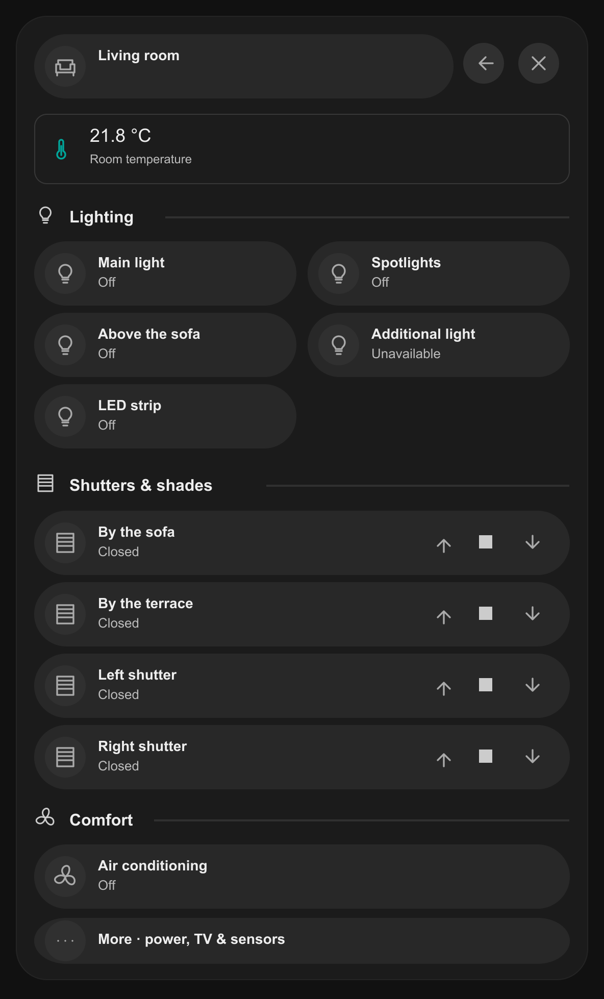
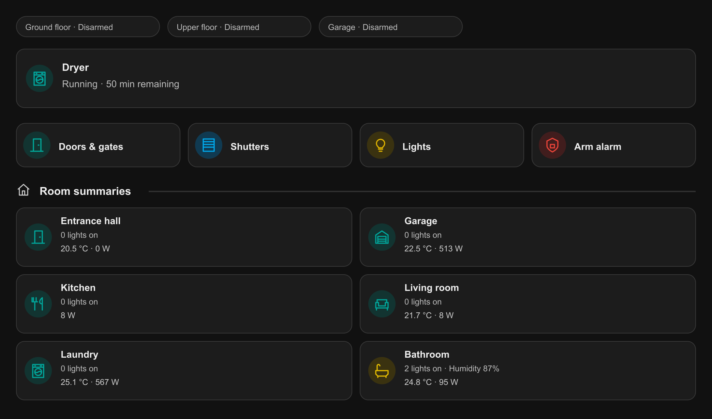

My Home Assistant dashboard had everything I needed. From an engineer's perspective, it was pretty much perfect: every useful control exposed, every interesting measurement available, the whole installation within reach. Unfortunately, it showed almost all of it at once. I understood it because I had built it, but even I was getting tired of looking at it.

I had been meaning to rebuild it for a long time. A few attempts ended with promising cards, some AI recommendations and the same uncomfortable thought: somebody still had to reorganise every room and deal with hundreds of individual entities. I expected several days of manual work. The existing dashboard worked, so postponing the job was easy.

Then it occurred to me: why was I assuming I had to do all that editing myself? Codex had browser support. I could open Home Assistant, give it the context and let it work on the actual interface with me. What I had been putting off for months became a project measured in hours, and the result is now my everyday dashboard.

## How my house ended up on one very crowded screen

My goal with Home Assistant has always been to integrate everything in the house that can reasonably be integrated. Lights, shutters, heating, motion and presence sensors, temperature and light-level readings, multimedia, the alarm, cameras, gates, appliances and energy monitoring all end up there. It is my own BMS — building management system — with roughly a thousand entities serving very different purposes.

Putting those systems together had already solved one problem: I could see and operate them in one place instead of treating every integration as a separate island. The dashboard had simply inherited too much of the machinery underneath. Each new device brought more controls and measurements, and I kept finding space for them. Eventually, checking a room meant scanning a small inventory of its equipment.

*The old approach: lights and shutters alongside multimedia, sensors and system status. Useful information, with little distinction between what mattered now and what was merely available.*

What I wanted was a different way of using the same system. The first screen should tell me what needed attention and provide the actions I used most. A room should open into its everyday controls, with occasional functions still accessible underneath. I did not need to rebuild the house's automations to achieve that; I needed to stop exposing their entire vocabulary on the home screen.

## Giving AI the job, not just a question

I had used AI for dashboard advice before, but fitting the recommended cards to my rooms remained my job. This time I opened the installation in **Codex's built-in browser** and asked the agent to take part in the rebuild. I also took it through HACS and the installed extensions, so it could see which cards and components were already available and use them in the design. My initial instructions were:

> Inspect my existing Home Assistant dashboard and the devices it exposes. I want to replace the overloaded layout with a readable, consistent, modern interface, following established dashboard usability practices.
>
> Keep the existing dashboard intact and build the replacement separately. Start with a living-room proposal, but choose an approach that can scale to the whole house. Prioritise everyday use over displaying every available entity. Use appropriate cards and extensions where they improve the experience.
>
> Preserve working controls and automations. Ask when the purpose of a device or the placement of a function is unclear. Show me a working first version so we can review it before repeating the pattern everywhere.

That gave the agent an outcome and some boundaries without pretending I already knew the final design. We kept the old dashboard and built the replacement as a separate dashboard. I could reject an idea without having overwritten the original, and we retained a reference for behaviour that already worked.

The agent could inspect the interface, use the dashboard editor, make changes and look at the result. There was still YAML involved, but I no longer had to carry every suggestion between the conversation and Home Assistant. This used my existing signed-in session; I did not expose the installation publicly to make the experiment work.

## One room first, then the house

We started with the living room. Codex asked what should dominate the view; my answer was lights, shutters and temperature. The first proposal arranged them into clear functional groups, but it also exposed the next problem: repeating that room page throughout the house would produce another oversized dashboard.

*A sensible first proposal, until I imagined repeating it across the whole house.*

My next direction was more specific: the living room was one of many rooms, and the interface needed to work as a whole. I wanted something closer to a modern application, with a panel opening from a compact room card and another level for less frequent functions. We moved towards **house → room → details**, using Mushroom and Bubble Card as building blocks. I gave Codex the following instructions:

> Build the main view around compact room cards, grouped by floor and outside areas. Each card should give me a useful summary; selecting it should open the room's everyday controls. Put less frequently used functions and individual measurements under More.
>
> Keep module order, naming, icon meaning and card dimensions consistent across rooms. The same type of control should not be prominent in one room and arbitrarily hidden in another. Allow deliberate exceptions: the TV belongs on the living-room panel, appliances in the laundry, and heating and humidity in bathrooms.
>
> Keep the overview light enough to scan. If adding information makes a card harder to read, reconsider its placement rather than simply making every card larger. Ask before making an ambiguous placement decision, then apply the agreed rule across the dashboard.

*The room panel became the reusable pattern. In this early version the television was still under More; I moved it forward later.*

Starting with one room let me decide what belonged on each level before spreading the design. The rooms did not need identical contents; they needed predictable organisation. Once that distinction was clear, applying the pattern across the house was exactly the repetitive work I had wanted help with.

## Steering the next version

Some iterations made things worse. After we enlarged the room cards to fit more information, they took up too much space. I did not need another design proposal; I needed a targeted adjustment to what was already on screen:

> The tiles are too tall now. Make them about three quarters of this height. Show the lights-on information first, with humidity beside it in bathrooms, then temperature and power consumption. Keep the same height and information order across rooms.

I could feed requirements into the conversation in stages instead of writing a complete specification upfront. When several things needed review, I paused the work: wait, let me collect the remaining comments, and only start changing things when I say I am finished. Giving Codex the whole set at once meant one coherent revision instead of a succession of partial fixes. That saved time and avoided spending tokens repeatedly revisiting the same cards and decisions.

A few corrections required knowledge of the house. The bathroom's night light should remain controllable without counting as a light someone had left on, and it should be excluded from the global light-off action. AI could inspect its entity, but I still needed to explain that role. Once explained, the decision could be applied to the room summary, room controls and shared action without me editing each separately.

Gate icons were another useful refinement. A control switch sends an impulse; it does not tell you whether the gate is still open. My instruction focused on the outcome:

> Wherever a gate or entrance door appears, link its displayed state to the corresponding contact sensor. The icon should clearly distinguish open, closed and unknown, while the button retains its existing control action. Apply the same behaviour everywhere that opening appears.

That made the icons useful feedback rather than decoration. There were ordinary implementation problems too: a new TV panel failed, and some energy readings disagreed with the old view. Codex could inspect the existing entities and working cards, so I pointed it to those references and asked it to reuse what worked. I did not need to turn each correction into a separate configuration tutorial.

## Reviewing the whole house

Once the rooms worked individually, I wanted a review of the complete interface. It was easy to improve one component and overlook the effect on the rest of the page, so I asked the agent to step back before making another change:

> Review the dashboard against established usability practices. Is the hierarchy clear? What is missing, duplicated, too prominent or unnecessarily hidden? Can I recognise important states and reach common actions without opening several panels?
>
> Check consistency between rooms, readability at different screen widths, and whether the overview contains useful summaries rather than another inventory of entities. Recommend what to add, remove or move, and explain the benefit. Do not change anything yet; let me review the findings first.

That gave us a way to challenge the result, not just keep adding to it. A separate clock added little, repeated readings did not need another card, and shutter controls fitted under one choice instead of two permanent buttons. Active appliances could tell me that the dryer was running and how long remained, without opening the laundry. Individual measurements stayed within reach without competing with everyday controls.

*Active work, common actions and room summaries. These are selected components from across the house, rather than the entire page.*

The practices that helped were simple: preserve the working dashboard, establish one room pattern, reuse existing controls and review the result before scaling it. Global actions kept their scope and confirmations; changing the interface should not quietly change which devices a command operates.

## The part that changed how I use AI

The biggest difference was that the result was visible to both of us. Codex was not just producing configuration and leaving me to find out what it looked like. Through the built-in browser, it could inspect the rendered interface too: the card proportions, the layout, the states and the result of an edit. I could point to a problem in that shared context instead of trying to reconstruct the page in a prompt.

That made the work feel much closer to reviewing a prototype with someone who could immediately implement the next decision. I described the intended experience, supplied the house-specific context and rejected bad trade-offs. The agent handled the repeated changes and brought back something concrete to judge. A correction to one room could become a rule for the others, and I spent my time making decisions rather than reproducing them in YAML.

What I expected to take several days was completed in a few hours. More importantly, I stopped postponing the rebuild, and the replacement is now my everyday interface to the house.

That was the eye-opener. I had been using AI for small pieces of work — recommend a card, write a snippet, explain an option — while keeping the entire burden of putting it together. This time I involved it in the whole task, from inspecting the starting point through design, implementation and review. I still directed the work, but I no longer had to be the person making every edit. That is the approach I will reach for the next time a useful project sits untouched because its individual steps look too tedious to begin.

<aside class="article-note" aria-label="About the illustrations">
The illustrations recreate selected dashboard components to keep sensitive details of my home setup private. Readings are illustrative.
</aside>
